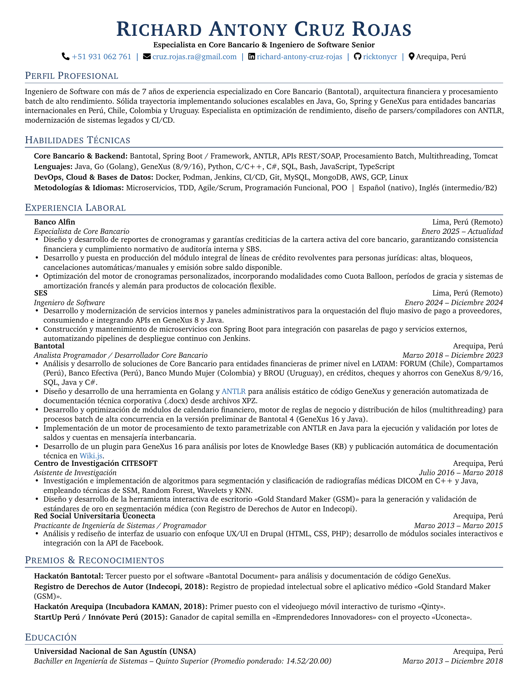

# Curriculum Vitae - Richard Antony Cruz Rojas

Curriculum Vitae (CV) desarrollado en LaTeX, optimizado para sistemas de seguimiento de candidatos (ATS) y maquetado en una sola página de alto impacto.

📄 **[Descargar CV en PDF](./RichardCruz_CV.pdf)**

## Uso con Makefile (Recomendado)

El proyecto incluye un `Makefile` que detecta automáticamente si tienes `pdflatex` instalado localmente o utiliza contenedores (`podman` / `docker`):

```sh
# Compilar PDF, actualizar vista previa PNG y limpiar archivos temporales
make

# Solo compilar el PDF
make build

# Actualizar imagen de vista previa (png/cv-0.png)
make preview

# Limpiar archivos temporales (.aux, .log, .out)
make clean
```

## Compilación Manual en Terminal

### Con TeX Live local:
```sh
pdflatex RichardCruz_CV.tex
```

### Con Podman / Docker:
```sh
podman run --rm -v $(pwd):/workdir:Z -w /workdir ghcr.io/xu-cheng/texlive-full pdflatex RichardCruz_CV.tex
```

## Vista Previa

<p align="center">
    <a href="./RichardCruz_CV.pdf">
        
    </a>
</p>

## Autor

👤 **Richard Antony Cruz Rojas**

* **LinkedIn:** [richard-antony-cruz-rojas](https://www.linkedin.com/in/richard-antony-cruz-rojas/)
* **GitHub:** [@ricktonycr](https://github.com/ricktonycr)
